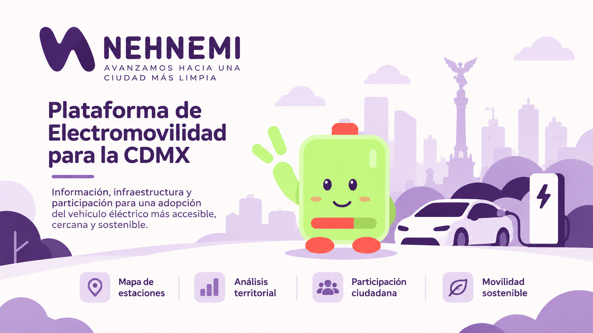

# Nehnemi



### Avanzamos hacia una ciudad más limpia

Nehnemi es una plataforma digital desarrollada para el
**Hackathon de Electromovilidad de la Ciudad de México**.

El proyecto busca contribuir a la transición hacia la
electromovilidad mediante herramientas tecnológicas que
faciliten el acceso a información, la participación ciudadana
y la planificación estratégica de infraestructura de carga.

---

## Sobre el proyecto

La adopción de vehículos eléctricos representa una
oportunidad para transformar la movilidad urbana.

Sin embargo, existen desafíos relacionados con:

- La disponibilidad de infraestructura de carga.
- La distribución territorial de estaciones.
- El acceso a información confiable.
- El desconocimiento sobre la electromovilidad.
- La participación ciudadana en la planificación.

Nehnemi propone abordar estos desafíos mediante
una plataforma que conecta información territorial,
infraestructura y participación ciudadana.

## Componentes

### Plataforma ciudadana

Permite acercar la electromovilidad a la población.

Sus funcionalidades incluyen:

- Visualización de estaciones de carga.
- Consulta de información sobre electromovilidad.
- Publicaciones educativas.
- Participación ciudadana.
- Solicitudes de infraestructura.
- Interacción con contenidos.

### Plataforma gubernamental

Proporciona herramientas de análisis para apoyar
la planificación de infraestructura.

Incluye:

- Visualización territorial de la CDMX.
- Análisis por alcaldía y AGEB.
- Indicadores de adopción.
- Indicadores de infraestructura.
- Indicadores de participación.
- Indicadores de accesibilidad.
- Identificación de necesidades territoriales.
- Consulta de solicitudes ciudadanas.

## Análisis territorial

Nehnemi utiliza información geoespacial para
analizar las condiciones de electromovilidad
en distintas zonas de la Ciudad de México.

El modelo contempla cuatro dimensiones:

| Dimensión | Propósito |
|-----------|-----------|
| Adopción | Analizar condiciones relacionadas con la adopción de vehículos eléctricos. |
| Infraestructura | Evaluar la distribución de infraestructura de carga. |
| Participación | Incorporar señales y necesidades ciudadanas. |
| Accesibilidad | Analizar el acceso territorial a infraestructura. |

El análisis utiliza unidades territoriales
como alcaldías y Áreas Geoestadísticas Básicas (AGEB).

## Arquitectura

El proyecto está organizado como un monorepo.

```text
Nehnemi/
├── frontend/
├── backend/
├── presentacion/
└── README.md
```

### Frontend

Tecnologías principales:

- React
- Vite
- Tailwind CSS
- MapLibre

### Backend

Tecnologías principales:

- Python
- FastAPI
- PostgreSQL
- PostGIS
- SQLAlchemy

## Lititio

Lititio es la mascota de Nehnemi.

Representa una forma cercana y accesible de
comunicar conceptos relacionados con la
electromovilidad.

A través de Lititio, Nehnemi busca facilitar
la comprensión de temas técnicos y promover
la participación de la ciudadanía.

## Origen

Este proyecto fue desarrollado como propuesta
para el **Hackathon de Electromovilidad de la
Ciudad de México**.

Nehnemi integra desarrollo de software,
análisis territorial, visualización de datos
y diseño de experiencias digitales.

Su propósito es explorar cómo la tecnología
puede contribuir a una movilidad urbana
más limpia, accesible e informada.

## Historial de desarrollo

Este repositorio integra los proyectos
originales de frontend y backend.

La migración conserva sus respectivos
historiales de Git, incluyendo commits,
autores y fechas originales.

Los repositorios de origen se mantienen
independientes.

---

**Nehnemi — Avanzamos hacia una ciudad más limpia.**
